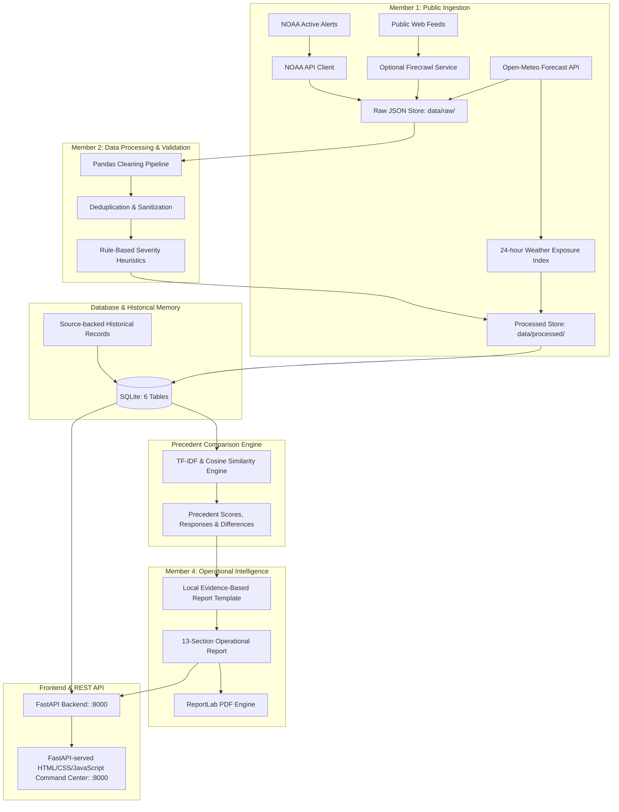

# LogisticsUpdate AI – Architecture Specification

## 1. System Overview
**LogisticsUpdate AI** ingests public supply-chain disruption data, calculates a transparent 24-hour weather exposure index from live forecasts, compares incidents against recorded historical precedents, and generates local template-based operational reports from stored evidence. Reports are not generative AI.

---

## 2. End-to-End System Architecture

---

## 3. Component Details & Module Ownership

### Member 1: Firecrawl Data Collection (`backend/services/firecrawl_service.py`)
- Fetches actual NOAA severe/extreme alerts without an API key and optionally uses Firecrawl to extract public logistics websites.
- Persists raw JSON payloads into `data/raw/` for complete auditability.
- Logs collection results and errors in `collection_logs`; it does not fabricate records if a provider is unavailable.

### Member 2: Data Processing & Cleaning (`backend/services/data_processing.py`)
- Uses Python and Pandas for tabular transformation:
  1. Empty and malformed record removal
  2. Duplicate elimination by URL and normalized title
  3. Text sanitization removing HTML tags and excessive spacing
  4. Date normalization to ISO 8601 UTC
  5. Category mapping into 8 canonical classes
  6. Location entity recognition for major maritime hubs and transit corridors
  7. Deterministic rule-based severity assignment (`Critical`, `High`, `Medium`, `Low`, `Unknown`) based on verifiable keywords
- Exports cleaned datasets to `data/processed/` as CSV and JSON.
- Excludes explicitly marked demo records and does not invent source publication dates.

### Member 3: Historical Context & Precedent Comparison (`backend/services/memento_manager.py` & `event_comparison.py`)
- Uses source-backed historical records and documented operational responses stored in SQLite; no bundled sample precedents are included.
- Stores historical disruptions, operational mitigation responses, and observed real-world outcomes.
- Implements scikit-learn TF-IDF n-gram vectorization and cosine similarity matching.
- Compares incoming events against precedent memory, outputting match percentages, common keywords, divergence factors, and operational lessons.

### Member 4: Operational Reports & FastAPI Dashboard (`backend/services/llm_service.py`, `report_service.py`, `app/`)
- Builds reports locally from the selected disruption and stored historical comparisons; no external AI provider or API key is used.
- Missing fields are identified as not recorded; recommendations are clearly described as general review prompts, not confirmed impacts.
- Formats reports into 13 sections:
  1. Executive Summary
  2. Current Disruption Details
  3. Disruption Category
  4. Location
  5. Severity and Justification
  6. Potential Operational Impact
  7. Historical Event Comparison
  8. Previous Operational Responses
  9. Key Changes & Dynamics
  10. Recommended Monitoring Actions
  11. Operational Considerations & Contingencies
  12. Source References
  13. Data Limitations and Uncertainties
- Generates official downloadable PDF documents via ReportLab.
- Serves a responsive operations dashboard from FastAPI static assets at `/`.
- Hosts the REST API and dashboard in one process, with interactive API documentation at `/docs`.
- Creates a transparent 24-hour weather exposure index from live Open-Meteo forecasts; the index is explicitly not a trained probability model.
