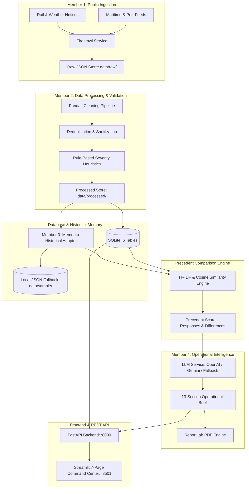

# LogisticsUpdate AI – Architecture Specification

## 1. System Overview
**LogisticsUpdate AI** is an operational intelligence platform designed to scrape live supply-chain disruption data, vectorize and benchmark it against historical precedents, and synthesize actionable, hallucination-free decision briefs for logistics managers.

---

## 2. End-to-End System Architecture

---

## 3. Component Details & Module Ownership

### Member 1: Firecrawl Data Collection (`backend/services/firecrawl_service.py`)
- Interfaces with Firecrawl API to extract structured markdown content and metadata from public logistics portals.
- Persists raw JSON payloads into `data/raw/` for complete auditability.
- Logs scrape results, errors, and rate limits in `collection_logs`.
- Includes a rich demonstration scraper for zero-credential offline evaluation.

### Member 2: Data Processing & Cleaning (`backend/services/data_processing.py`)
- Uses Python and Pandas for tabular transformation:
  1. Empty and malformed record removal
  2. Duplicate elimination by URL and normalized title
  3. Text sanitization removing HTML tags and excessive spacing
  4. Date normalization to ISO 8601 UTC
  5. Category mapping into 8 canonical classes
  6. Location entity recognition for major maritime hubs and transit corridors
  7. Deterministic rule-based severity assignment (`Critical`, `High`, `Medium`, `Low`, `Unknown`) based on verifiable keywords
- Exports cleaned datasets to `data/processed/` as CSV and JSON.

### Member 3: Historical Context & Precedent Comparison (`backend/services/memento_manager.py` & `event_comparison.py`)
- Dedicated Memento adapter supporting cloud API connectivity or clear Local Development fallback.
- Stores historical disruptions, operational mitigation responses, and observed real-world outcomes.
- Implements scikit-learn TF-IDF n-gram vectorization and cosine similarity matching.
- Compares incoming events against precedent memory, outputting match percentages, common keywords, divergence factors, and operational lessons.

### Member 4: Generative AI Briefs & Streamlit Dashboard (`backend/services/llm_service.py`, `report_service.py`, `app/`)
- Integrates configurable LLM backends (OpenAI GPT-4o-mini, Google Gemini, or deterministic fallback).
- Enforces strict no-hallucination guardrails: citations must match input source records; severities cannot be hallucinated.
- Formats all operational intelligence briefs into 13 mandatory sections:
  1. Executive Summary
  2. Current Disruption Details
  3. Disruption Category
  4. Location
  5. Severity and Justification
  6. Potential Operational Impact
  7. Historical Event Comparison
  8. Previous Operational Responses
  9. Key Changes & Dynamics
  10. Recommended Monitoring Actions
  11. Operational Considerations & Contingencies
  12. Source References
  13. Data Limitations and Uncertainties
- Generates official downloadable PDF documents via ReportLab.
- Directs the 7-page dark navy Streamlit command dashboard.
